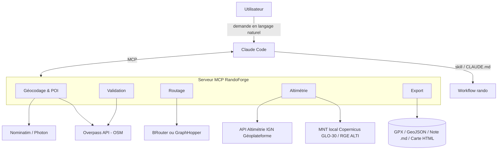
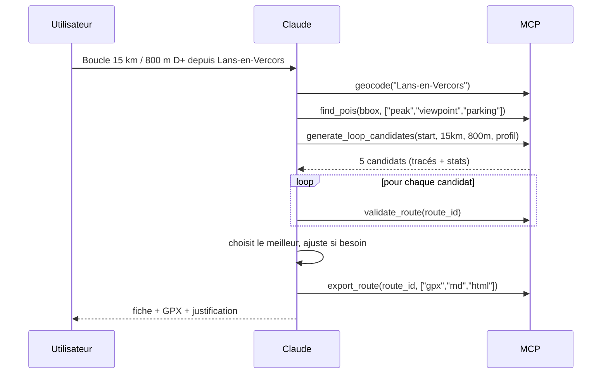

# Architecture globale

## Vue d'ensemble



## Les 4 couches

### 1. Couche « intelligence » — Claude
- Comprend la demande, pose les questions manquantes (niveau, durée, départ).
- Planifie : choisit les waypoints, appelle les outils, compare les candidats.
- **Ne calcule rien lui-même.** Toute donnée chiffrée vient d'un outil.
- Guidé par le skill `skills/planifier-rando` et le [[Workflow de Claude]].

### 2. Couche « outils » — serveur MCP
- Interface stable, typée (schémas JSON), documentée → voir [[Serveur MCP - Outils]].
- Outils **déterministes** et **idempotents** : même entrée = même sortie.
- Chaque réponse renvoie des **métadonnées de provenance** (source, résolution MNT, date des données).

### 3. Couche « moteurs » — services spécialisés
- Routage : moteur existant, on ne réinvente pas Dijkstra → [[ADR-002 - Routage par moteur existant]].
- Altimétrie : MNT, avec lissage → [[Calcul du dénivelé]].
- Données : OSM via Overpass → [[Sources de données]].

### 4. Couche « persistance »
- Cache local (SQLite) des réponses Overpass / altimétrie → reproductibilité + respect des quotas.
- Itinéraires générés stockés en fichiers (`/routes/<id>/route.gpx`, `fiche.md`, `meta.json`).

## Flux type : « boucle de 15 km, 800 m D+ depuis Lans-en-Vercors »



## Principes de conception
1. **Le chiffre vient toujours d'un outil** (traçabilité).
2. **Fail loud** : un outil qui doute renvoie un warning explicite, jamais une valeur silencieusement fausse.
3. **Route = objet central** identifié par `route_id`, que tous les outils manipulent (évite de faire transiter 5 000 points dans le contexte de Claude).
4. **Réponses compactes** pour Claude (stats + résumé), données lourdes sur disque.
5. **Testable hors Claude** : chaque outil est une fonction Python testée unitairement.

## Performances des calculs locaux (mesuré le 2026-10-16)
Itinéraire synthétique de 66 km densifié à 10 m (7 808 points), mesure : `uv run python scripts/bench_calculs.py` :

| Calcul | Avant | Après | Changement |
|---|---|---|---|
| `overlap_fraction` (recouvrement avec une rando faite, par candidat de boucle) | 569 ms | 55 ms | `dwithin` sur géométrie préparée (résultat identique) |
| `deviation` (écart à une trace de référence) | ~690 ms | ~70 ms | index STRtree des segments, `query_nearest` (distances identiques) |
| `probe_points` (sondes de pente des bivouacs) | 79 ms | 6 ms | un seul calcul géodésique vectorisé |
| `densify` | boucle Python | 2 ms | vectorisé |

Le reste (stats 21 ms, validation 60 ms dont allers-retours 45 ms, carte 23 ms, GPX 77 ms via gpxpy, lecture du stockage
20 ms) est négligeable devant les appels réseau (BRouter, IGN, Overpass : secondes), déjà parallélisés et mis en cache.

## Arborescence de code envisagée
```
randoforge/
├── src/randoforge/
│   ├── server.py          # point d'entrée MCP (MCPServer, SDK 2.x)
│   ├── app.py, services.py# contexte partagé, services externes injectables
│   ├── tools/             # outils par thème : search, build, analyze, trek, output
│   ├── engines/           # BRouter, IGN/Copernicus/MNT local, Nominatim, Overpass, refuges.info, Open-Meteo, Wikidata
│   ├── core/              # calculs purs : géo, D+, pentes, POI, technique, zones, bivouac, étapes, soleil, météo
│   ├── validation.py      # ~35 règles
│   └── formats/           # gpx, markdown, carte html, roadbook
├── .claude-plugin/, skills/  # plugin Claude Code
├── scripts/               # démonstration, calibration
├── tests/                 # pytest + traces de référence
├── data/cache/            # SQLite, tuiles MNT
└── routes/                # itinéraires générés
```
