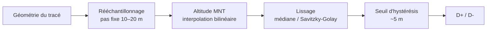

# Calcul de la distance et du dénivelé

> Le D+ est **le chiffre le plus souvent faux** dans les outils de rando. Cause principale : le bruit du MNT et de l'échantillonnage, qui s'accumule à chaque petite oscillation.

## Distance
- Calcul **géodésique** sur l'ellipsoïde WGS84 (`pyproj.Geod.inv` ou `geographiclib`), pas Haversine sphérique ni distance plane.
- Distance **2D** (convention de toutes les applis de rando). La distance 3D peut être donnée à titre informatif (+1 à 3 % en montagne).
- Densifier le tracé si des segments sont longs (> 50 m) avant l'échantillonnage altimétrique.

## Pipeline D+ / D-

1. **Rééchantillonnage à pas fixe** (ex. 10 m) : rend le résultat indépendant de la densité de points du moteur de routage.
2. **Altitude MNT** avec interpolation bilinéaire (pas plus-proche-voisin).
3. **Lissage** : filtre médian de **30 m** (3 points) pour retirer pics et artefacts.
4. **Hystérésis par extremums** : une montée n'est validée qu'au moment où l'on redescend d'au moins le seuil (**5 m** par défaut) depuis le point le plus haut atteint, et inversement.
5. Les paramètres (pas, fenêtre, seuil) sont **renvoyés dans les métadonnées** pour la traçabilité.

### Hystérésis : pourquoi suivre les extremums
Une version naïve (« compter dès qu'on s'écarte du seuil depuis le dernier point validé ») perd jusqu'au seuil à chaque sommet et chaque col : sur une montée à 102 m elle donne 100 m. La version implémentée (`core/elevation.py`) garde l'extremum candidat et le valide au demi-tour → 102 m. Couvert par un test.

### Mesures ayant fixé les valeurs par défaut (2026-10-15)
Profils synthétiques, pas de 10 m, seuil 5 m — D+ calculé :

| Fenêtre médiane | Sommet en V, 300 m, pente 30 % | 500 m + bruit MNT σ = 2 m | 500 m + pics isolés de 25 m |
|---|---|---|---|
| 0 (aucune) | 300 | 580 (+16 %) | 740 (+48 %) |
| **30 m** | **297** | **502** | **523** |
| 60 m | 294 | 502 | 521 |
| 100 m | 291 | 502 | 519 |

→ 30 m élimine le bruit et ne coûte que ~3 m sur un sommet très pointu. Au-delà, on écrête les sommets sans gain. (Les ~20 m restants dans la colonne « pics » viennent des pics placés au tout premier et au tout dernier point, que le médian ne peut pas corriger aux bords.)

## Calibration sur des références officielles (2026-10-15)

**Peut-on calibrer le D+ de façon fiable ?** Il n'existe pas de « vrai » D+ absolu : il dépend du lissage,
et même deux altimètres barométriques diffèrent de 3 à 5 %. Les références les plus sérieuses disponibles
librement, utilisées ici :

1. **Itinéraires publiés par les parcs nationaux** (plateforme Geotrek : Écrins 727, Cévennes 541 itinéraires) —
   tracé + D+ des topo-guides officiels. Référence cohérente, mais elle-même calculée sur un MNT par chaque parc.
2. **Altitudes officielles des sommets** (cartes IGN, reprises dans OSM) — vérité terrain ponctuelle pour le MNT.
3. *(optionnel)* **Tes traces de montre barométrique** — `scripts/calibrate.py`.

Résultats détaillés et reproductibles : [[Calibration du dénivelé]] (`scripts/calibrate_reference.py --report`).

| Mesure (80 itinéraires pédestres) | Résultat |
|---|---|
| Écart médian de D+ vs topo-guides officiels | **5,0 %** (Écrins 4,2 %, Cévennes 6,0 %), biais +0,7 % |
| Itinéraires à moins de 10 % | 71 % |
| Distance vs distance publiée | 0,0 % d'écart médian |
| Sommets arrondis (Cévennes) : MNT vs altitude officielle | 0,2 m de biais médian |
| Pics acérés (Écrins) : MNT vs altitude officielle | **−43 m** : les MNT tronquent les pointes |

**Décisions**
- **Réglages par défaut conservés (30 m / 5 m).** Le réglage globalement « meilleur » (60 m / 3 m) améliore les
  Écrins (2,2 %) mais dégrade les Cévennes (10,1 %) : les deux parcs ne calculent pas leur D+ de la même façon.
  Se caler sur l'un reviendrait à épouser sa méthode, pas à gagner en précision.
- **Règle N2** : quand le tracé atteint un sommet dont l'altitude officielle dépasse le MNT de plus de 15 m,
  l'utilisateur est averti que le D+ réel est probablement supérieur d'autant.
- Tests de non-régression : `tests/e2e/test_reference.py` (écart médian ≤ 8 % par parc, distance ≤ 1 %,
  sommets arrondis ≤ 5 m).

## Pièges connus
- **Ponts et tunnels** : le MNT donne l'altitude du terrain (fond de vallée / sommet de montagne). → Interpoler linéairement l'altitude entre les extrémités pour les ways OSM `bridge=yes` / `tunnel=yes`.
- **Falaises / sentiers en corniche** : un MNT 30 m peut « tomber » de la falaise. → Préférer RGE ALTI 1–5 m en France.
- **Boucle** : D+ doit ≈ D- (écart < 1 %). Sinon, bug → vérifié par [[Validation & cohérence]].
- **Altitudes des sommets** : comparer l'altitude max calculée au tag `ele` OSM du sommet traversé (écart attendu < 10–15 m).

## Calibration
Constituer un **jeu de référence** de 10–20 randos connues (GPX barométriques + topo-guides) et ajuster `pas`, `fenêtre`, `seuil` pour minimiser l'erreur. → tâche dans [[Roadmap]].

## Estimation de durée
Méthode type **DIN 33466** (utilisée par les clubs alpins) :
- temps horizontal = distance / 4 km/h
- temps vertical = D+ / 300 m/h + D- / 500 m/h
- durée = max(h, v) + min(h, v) / 2

Paramètres ajustables par le profil marcheur. Pauses non incluses (le préciser dans la fiche).
